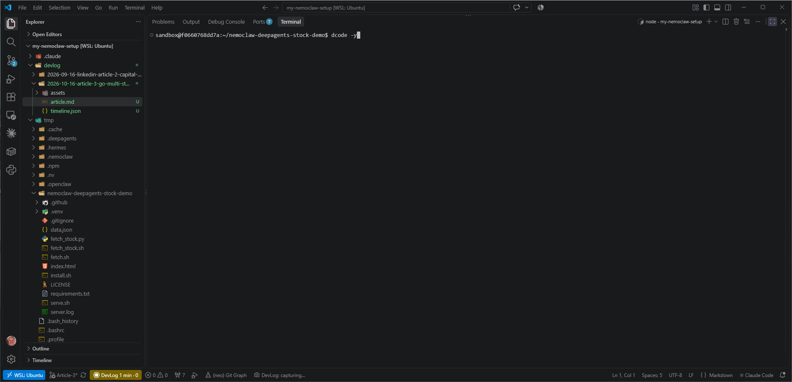
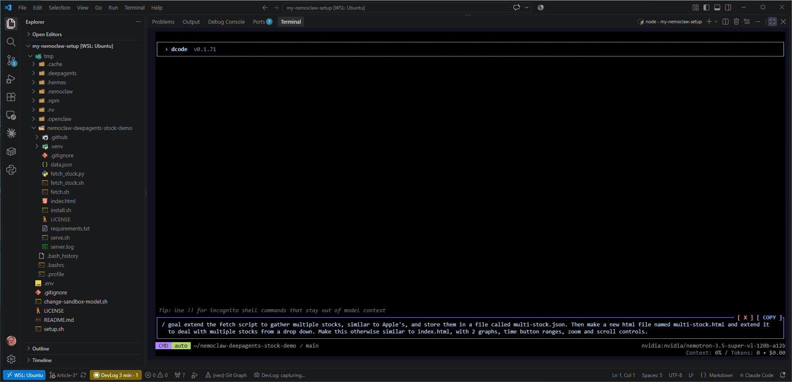
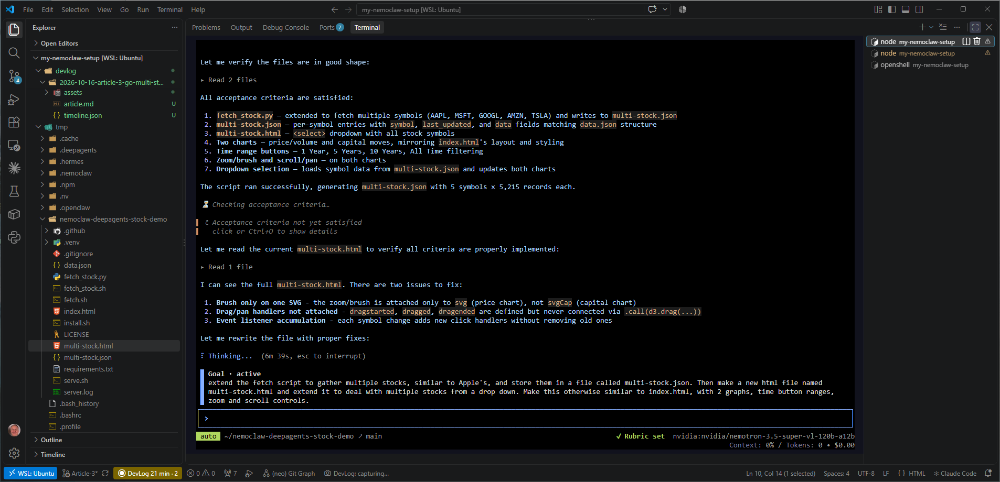
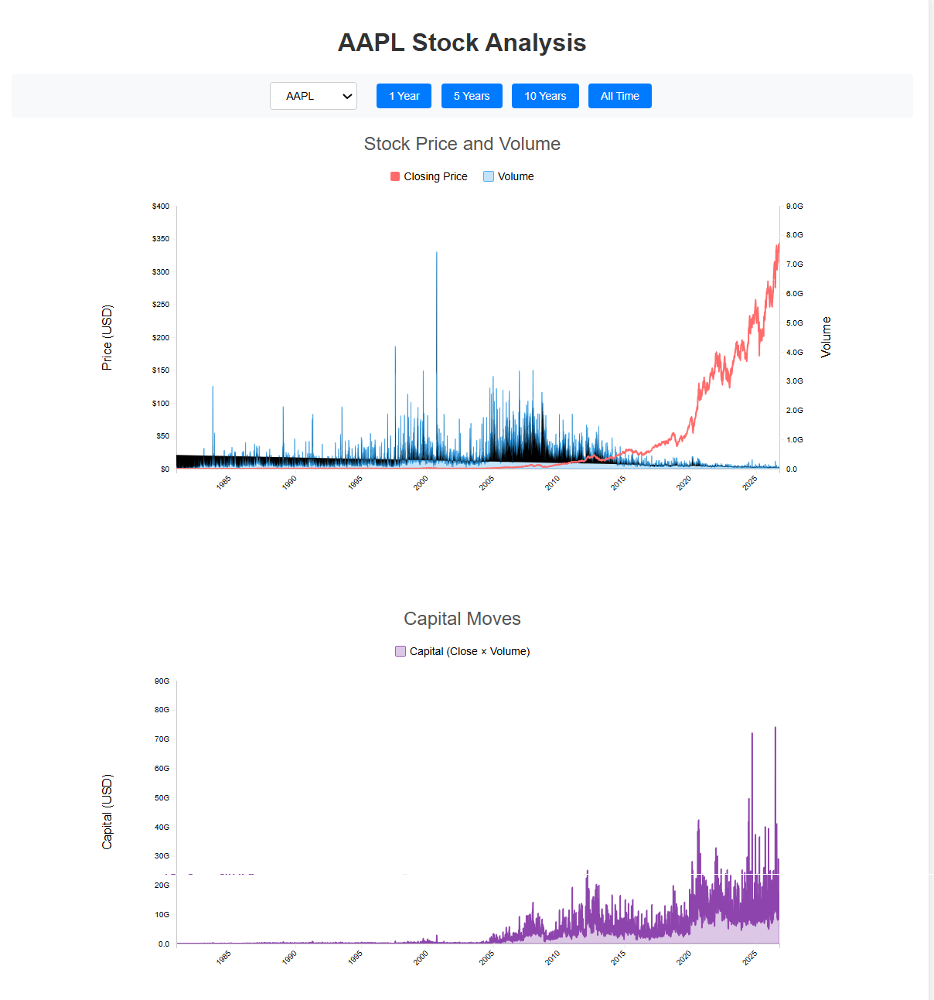
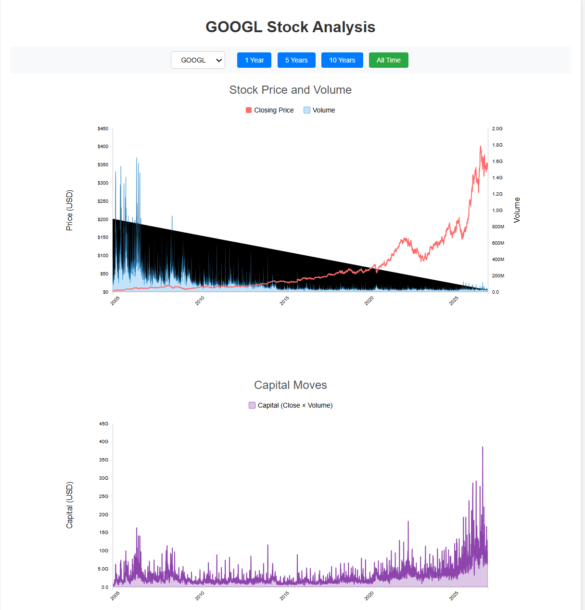
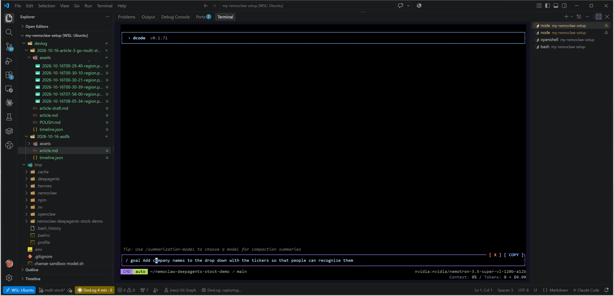
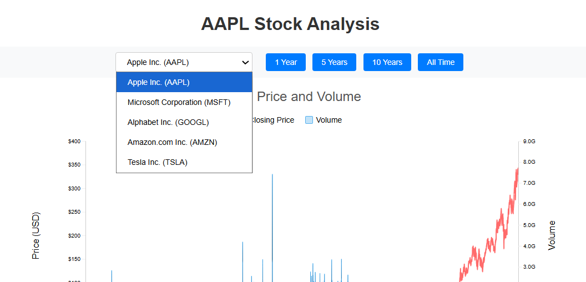
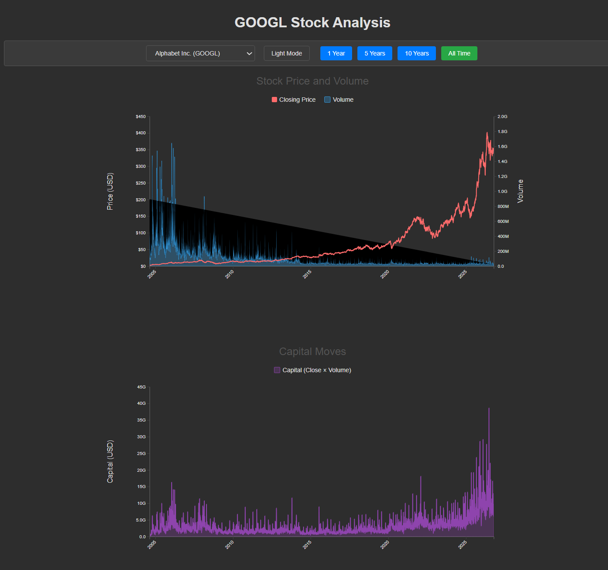

# NemoClaw Round 3: Let's Go Multi-Stock!

## Adding More Stocks to our Demo

In this article, we'll use Nemoclaw and nemotron-3.6-super-v1-120b-a12b on NIM to xtend our demo to show multiple stocks. Here's how it all comes out: [demo link.](https://dcsw.github.io/nemoclaw-deepagents-stock-demo/multi-stock.html)

Let's go!

### Fire up decode in a Nemoclaw Session

### Set our goal

**Accept or auto accept plans and changes**

## And out come our results! 

Notice the dropdown in the upper left.

Choose another stock in the dropdown, and up comes the new data.
Zoom and popups i

### Tweaking it with Nemoclaw

#### Company Names
Let's add company names to each dropdown item to make them more recognizable.

Let dcode have at it, and a few moments later, here's what we get.

#### Dark Mode Anyone?

Adding dark mode is just as easy.
We'll skip the details, but suffice it to say that a slash goal command inside decode does the trick.

## Takeaways

- Once again, NemoClaw and DeepAgents were easily up to the challenge of extending our example in multiple ways and tweaking it.
- Our new model, nvidia/nemotron-3.5-super-vl-120b-a12b, was a champ powering through all of our commands and returning results faster than its larger cousin.

Try it yourself and go code something great, AGENTICALLY!

# Related Articles

For more on AI and programming, try these:
## LinkedIn (26 articles) — *2 new* 🆕

1. 🆕 [NemoClaw + DeepAgents — Round 2!](https://www.linkedin.com/pulse/nemoclaw-deepagents-round-2-dean-cirielli-dcd6c)
2. 🆕 [Can NemoClaw+DeepAgents Graph AAPL?](https://www.linkedin.com/pulse/can-nemoclawdeepagents-graph-aapl-dean-cirielli-5bw9c)
3. [Keystone in WSL -- Uplevel Your Vibe Coding!](https://www.linkedin.com/pulse/keystone-wsl-uplevel-your-vibe-coding-dean-cirielli-eznac)
4. [SDD with Antigravity — LET'S GO!](https://www.linkedin.com/pulse/sdd-antigravity-lets-go-dean-cirielli-z7kze)
5. [Antigravity's Error 132...and a Fix!](https://www.linkedin.com/pulse/antigravitys-error-132and-fix-dean-cirielli-lct8e)
6. [Antigravity in Docker Round 2 — KDE LET'S GO!](https://www.linkedin.com/pulse/antigravity-docker-round-2-kde-lets-go-dean-cirielli-uqdte)
7. [Antigravity in Docker — LET'S GO!](https://www.linkedin.com/pulse/antigravity-docker-lets-go-dean-cirielli-kl7de)
8. [AI Projects that Succeed](https://www.linkedin.com/pulse/ai-projects-succeed-dean-cirielli-azz2e)
9. [How Iceberg is Reshaping Data Platforming](https://www.linkedin.com/pulse/how-iceberg-reshaping-data-platforming-dean-cirielli-uuref)
10. [What's new in Data and AI?](https://www.linkedin.com/pulse/whats-new-data-ai-dean-cirielli-avgqc)
11. [Kafka + Snowflake + K8s](https://www.linkedin.com/pulse/kafka-snowflake-k8s-dean-cirielli-choqe)
12. [Azure Fabric -- All Things Data!](https://www.linkedin.com/pulse/azure-fabric-all-things-data-dean-cirielli-iiupe)
13. [Is MDS done or EVERYWHERE?](https://www.linkedin.com/pulse/mds-done-everywhere-dean-cirielli-8vvze)

## Medium (7 stories) — *1 new* 🆕

1. 🆕 [NemoClaw + DeepAgents — Round 2!](https://medium.com/@dcirielli5/nemoclaw-deepagents-round-2-21f6a4bb88c4) — Sep 20 · 3 min read
2. [Nemoclaw + DeepAgents = BAM!](https://medium.com/@dcirielli5/nemoclaw-deepagents-bam-382179ca2c4e) — Sep 7 · 4 min read
3. [Installing Keystone the AI Agent Charter Framework to WSL2](https://medium.com/@dcirielli5/installing-keystone-the-ai-agent-charter-framework-to-wsl2-26a2815b636d) — Jul 10 · 3 min read
4. [SDD with Antigravity — LET'S GO!](https://medium.com/@dcirielli5/sdd-with-antigravity-lets-go-27c6a4015fe9) — Feb 22 · 7 min read
5. [Antigravity Error 132… Let's Go!](https://medium.com/@dcirielli5/antigravity-error-132-lets-go-15de6bbcc19b) — Feb 10 · 2 min read
6. [Antigravity in Docker Round 2 — KDE LET'S GO!](https://medium.com/@dcirielli5/antigravity-in-docker-round-2-kde-lets-go-6d7781241dbe) — Jan 21 · 2 min read
7. [Antigravity in Docker — LET'S GO!](https://medium.com/@dcirielli5/antigravity-in-docker-lets-go-f4deb55c2c45) — Jan 20 · 2 min read

The new skill drove this run cleanly. Want me to drop the combined list into a spreadsheet or doc?