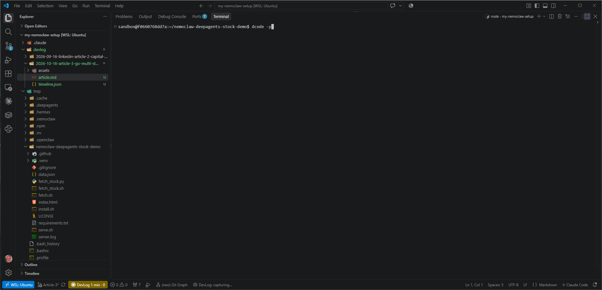
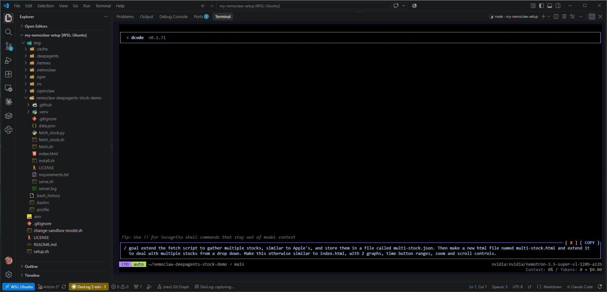
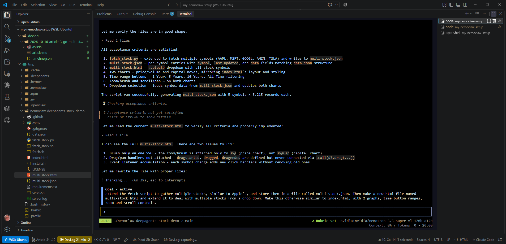
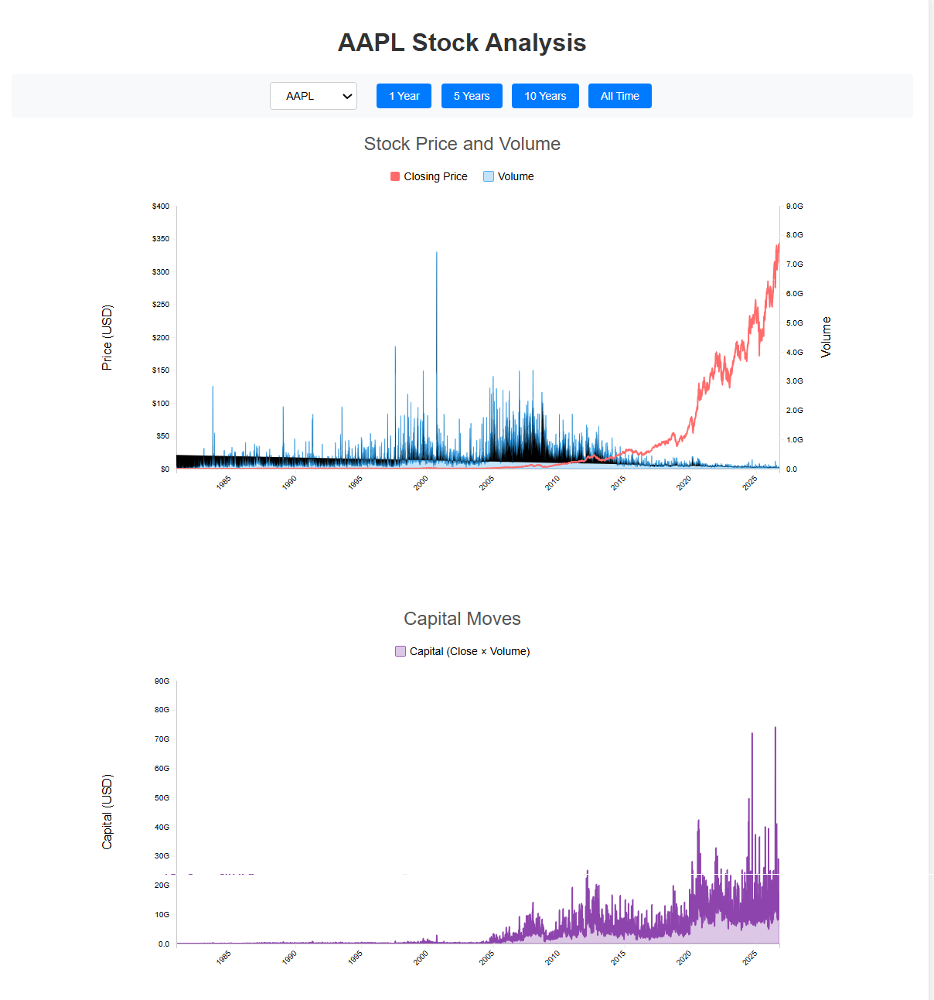
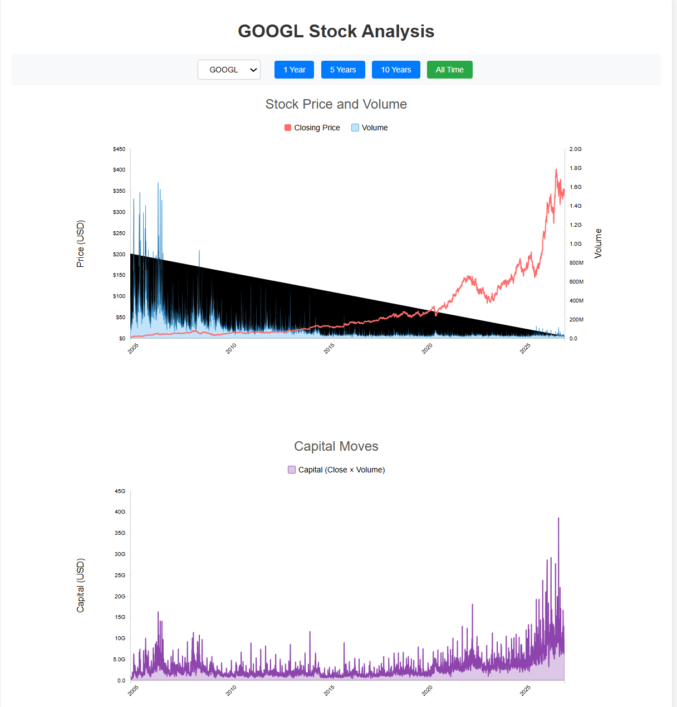
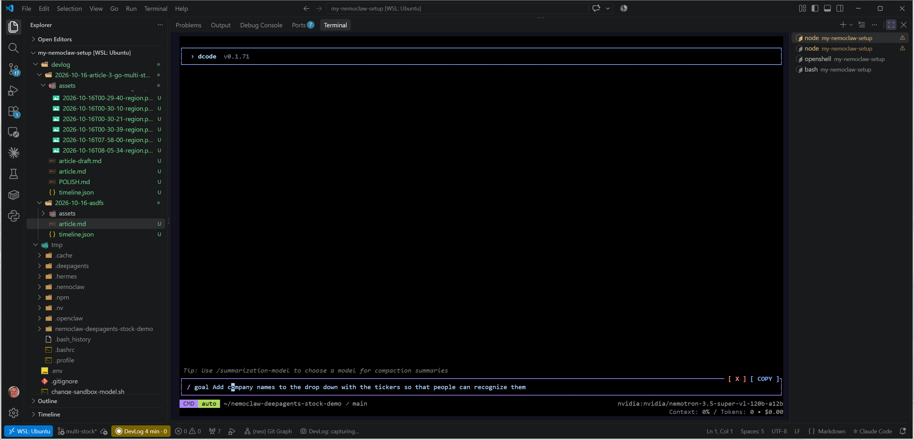
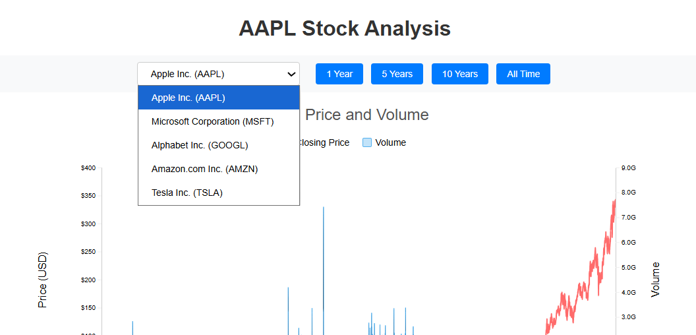

# Article 3: Let's Go Multi-Stock!

> **Goal.** Extend our demo to multiple stocks

<!-- Write freely anywhere in this file. DevLog Scribe only ever inserts at the
     marker near the bottom, so your prose is never overwritten. -->

## Session log

### 00:06 · 🎬 Started: Article 3: Go Multi-Stock!

**Goal.** Extend our demo to multiple stocks

### 00:07 · 📸 Fire up decode

while looking at `devlog/2026-10-16-article-3-go-multi-stock/article.md`

### 00:10 · 📸 Set our goal

while looking at `devlog/2026-10-16-article-3-go-multi-stock/article.md`

### 00:27 · 📸 Accept or auto accept plans and changes

while looking at `tmp/nemoclaw-deepagents-stock-demo/multi-stock.html`

### 00:29 · 📸 And here are our results! Notice the dropdown in the upper left.

while looking at `tmp/nemoclaw-deepagents-stock-demo/multi-stock.html`

### 00:31 · 📸 Choose another stock in the dropdown, and up comes the new data.

while looking at `tmp/nemoclaw-deepagents-stock-demo/multi-stock.html`

### 00:32 · 🏁 Session ended

new data.](assets/2026-10-16T08-05-34-region.png)

### Tweaking it with Nemoclaw
Let's add company names to each dropdown item to make them more recognizable.

Let dcode have at it, and a few moments later, here's what we get.

# Takeaways

- Nemoclaw with dcode tackled our enhanmcements quickly and gracefully -- multi-stocks, dark

# Related Articles

For more on AI and programming, try these:

## LinkedIn (24 articles)

1. [Keystone in WSL -- Uplevel Your Vibe Coding!](https://www.linkedin.com/pulse/keystone-wsl-uplevel-your-vibe-coding-dean-cirielli-eznac)
2. [SDD with Antigravity — LET'S GO!](https://www.linkedin.com/pulse/sdd-antigravity-lets-go-dean-cirielli-z7kze)
3. [Antigravity's Error 132...and a Fix!](https://www.linkedin.com/pulse/antigravitys-error-132and-fix-dean-cirielli-lct8e)
4. [Antigravity in Docker Round 2 — KDE LET'S GO!](https://www.linkedin.com/pulse/antigravity-docker-round-2-kde-lets-go-dean-cirielli-uqdte)
5. [Antigravity in Docker — LET'S GO!](https://www.linkedin.com/pulse/antigravity-docker-lets-go-dean-cirielli-kl7de)

## Medium (6 stories)

1. [Nemoclaw + DeepAgents = BAM!](https://medium.com/@dcirielli5/nemoclaw-deepagents-bam-382179ca2c4e) — 3 min read
2. [Installing Keystone the AI Agent Charter Framework to WSL2](https://medium.com/@dcirielli5/installing-keystone-the-ai-agent-charter-framework-to-wsl2-26a2815b636d) — 3 min read
3. [SDD with Antigravity — LET'S GO!](https://medium.com/@dcirielli5/sdd-with-antigravity-lets-go-27c6a4015fe9) — 7 min read
4. [Antigravity Error 132… Let's Go!](https://medium.com/@dcirielli5/antigravity-error-132-lets-go-15de6bbcc19b) — 2 min read
5. [Antigravity in Docker Round 2 — KDE LET'S GO!](https://medium.com/@dcirielli5/antigravity-in-docker-round-2-kde-lets-go-6d7781241dbe) — 2 min read
6. [Antigravity in Docker — LET'S GO!](https://medium.com/@dcirielli5/antigravity-in-docker-lets-go-f4deb55c2c45) — 2 min read
